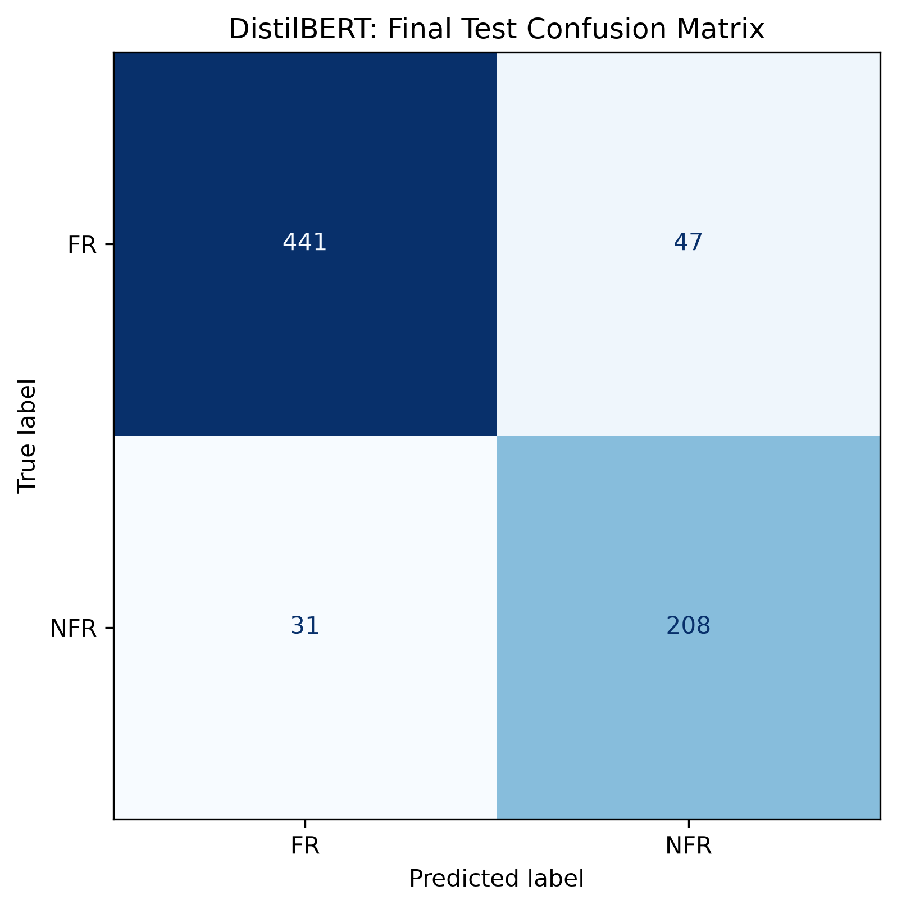
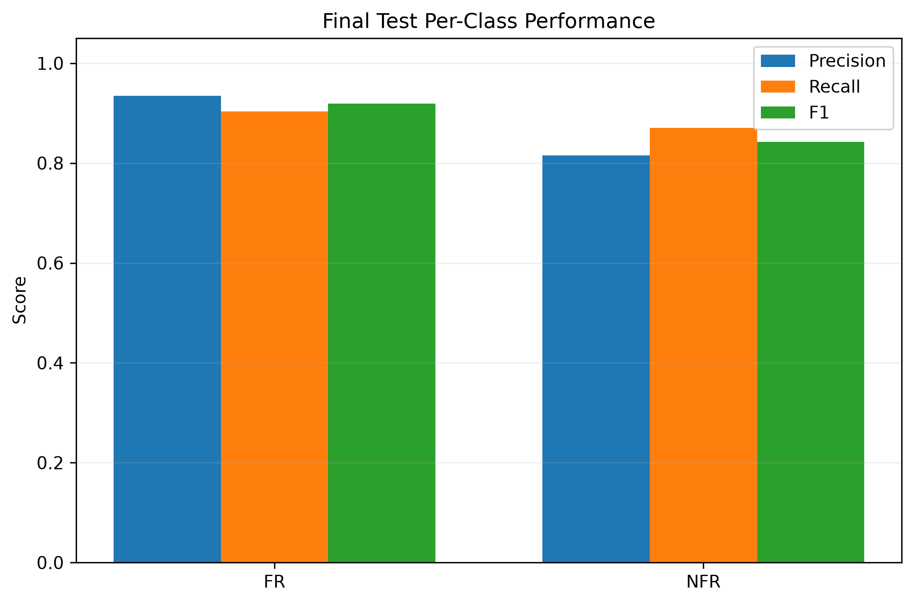
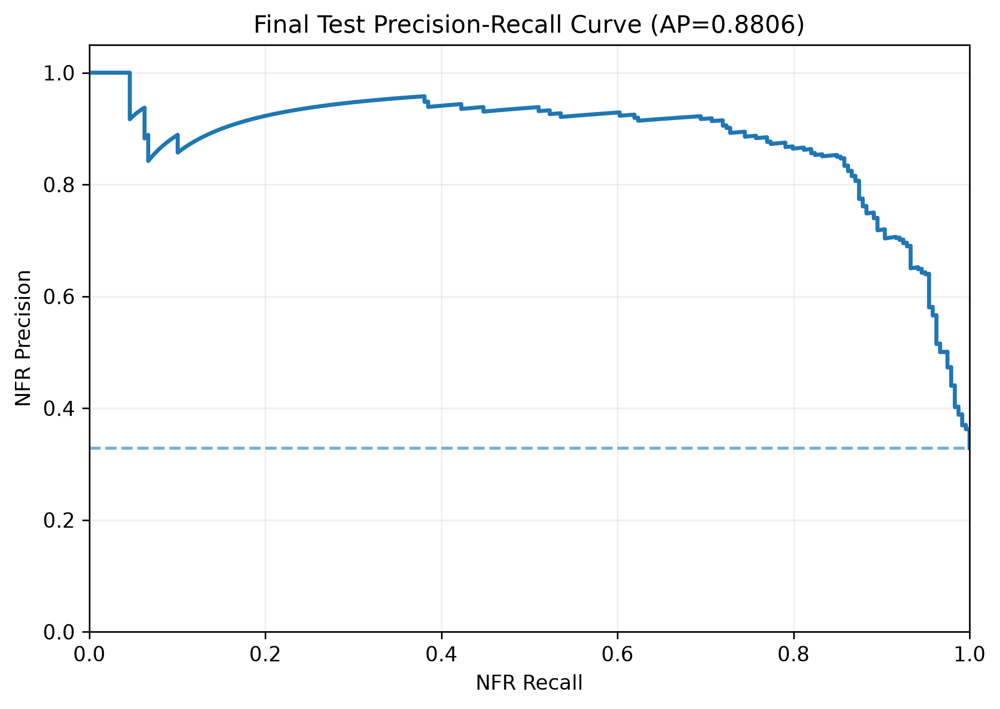
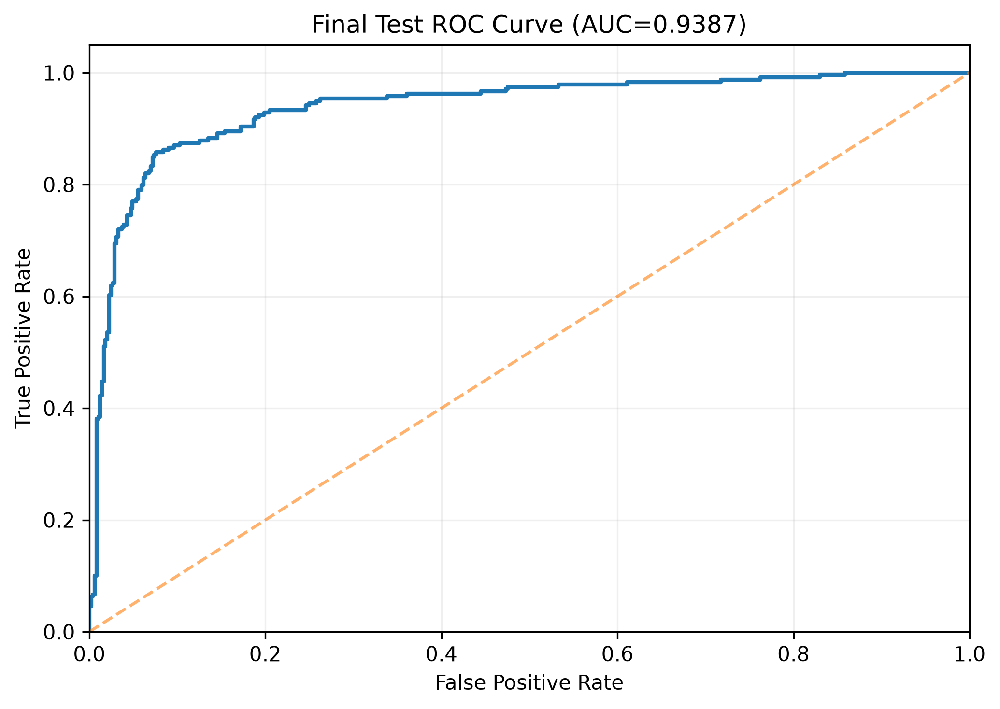

# Software Requirements Classification Research

**Binary classification of Functional Requirements (FR) and Non-Functional Requirements (NFR) using classical machine learning and deep learning.**

This repository documents an end-to-end research workflow covering dataset inspection, source and label verification, duplicate-aware data preparation, classical ML baselines, neural and transformer experiments, and a frozen final DistilBERT evaluation. The work is organized into separate stages so the methodology, intermediate decisions, and final results can be examined independently.

## Research at a glance

| Item | Description |
|---|---|
| Research task | Binary software requirements classification: **FR vs NFR** |
| Starting data | **8,854** records in a combined multi-source dataset (source identifiers **D1–D5**) |
| Selected source | **D2**, originally **4,993** records |
| Final research dataset | **D2 v1.1: 4,833** requirements, following quality review and filtering |
| Data partitions | **3,378 train / 728 validation / 727 held-out test** |
| Models investigated | Logistic regression, SVM and other classical ML models; TextCNN, BiLSTM, DistilBERT, BERT, and RoBERTa |
| Selected final model | **DistilBERT**, original **seed 42** checkpoint, threshold **0.50** |
| Final test result | **89.27% accuracy**, **84.21% NFR F1**, **87.03% NFR recall** |

## Dataset and experimental protocol

The starting resource, *A Unified Multi-Source Dataset of Software Requirements*, combines records from multiple constituent sources. Its five source partitions have different label distributions, provenance, and data-quality concerns. **The combined 8,854-record dataset was examined, but it was not used wholesale to train and test the final model.**

After auditing source consistency, labels, conflicting or repeated texts, project metadata, and possible overlap between partitions, the research proceeded with the **D2** source. Additional verification, filtering, annotation-review preparation, and similarity grouping produced the frozen **D2 v1.1** binary FR/NFR dataset.

| Frozen D2 v1.1 partition | FR | NFR | Total | Use |
|---|---:|---:|---:|---|
| Training | 2,224 | 1,154 | 3,378 | Fit models and conduct training-based experiments |
| Validation | 489 | 239 | 728 | Compare architectures, assess stability, and choose the final checkpoint |
| Held-out test | 488 | 239 | 727 | Evaluate the selected frozen model once |
| **Total** | **3,201** | **1,632** | **4,833** | |

The split separates recorded **similarity groups** to reduce related-text leakage between partitions. **Independence at the original-project level has not been fully established.** The held-out test set was not used for model selection, checkpoint choice, or post-test threshold tuning.

For the detailed preparation procedure, see [Dataset Exploration](dataset_exploration/README.md).

### Evaluation figures

The figures below were generated from the saved final test predictions and are tracked in `final_model/outputs/figures/`.

| Confusion matrix | Per-class precision, recall and F1 |
|---|---|
|  |  |

| Precision-recall curve | ROC curve |
|---|---|
|  |  |

PDF versions of these figures and the full results are available under [`final_model/outputs/`](final_model/outputs/).

## Experimental workflow

| Stage | Folder | Work performed |
|---|---|---|
| 1. Dataset examination and selection | [`dataset_exploration/`](dataset_exploration/README.md) | Source inventory, schema and quality checks, label/provenance audits, duplicates and conflicts, D2 v1.1 preparation, frozen splits, similarity checks |
| 2. Classical ML baselines | [`research_modeling/`](research_modeling/README.md) | TF-IDF-based baselines, logistic regression, linear/RBF SVM, additional ML methods, grouped cross-validation, threshold and feature analyses |
| 3. Deep learning research | [`deep_learning_research/`](deep_learning_research/README.md) | TextCNN, BiLSTM, DistilBERT, BERT, RoBERTa, three-seed transformer comparisons, error/annotation analyses, final model-selection freeze |
| 4. Final evaluation and archive | [`final_model/`](final_model/README.md) | Checkpoint integrity verification, one-time frozen test inference, figures, consolidated evaluation report, SHA-256 archive verification |

### Transformer validation comparison

| Model | Mean NFR F1 (3 seeds) | Standard deviation |
|---|---:|---:|
| **DistilBERT** | **0.8634** | **0.0036** |
| BERT-base | 0.8590 | 0.0096 |
| RoBERTa-base | 0.8557 | 0.0050 |

These are **validation** summaries, not test-set comparisons. DistilBERT led by mean NFR F1 in these runs; the small differences do not establish statistically significant superiority. The final checkpoint is the original DistilBERT **seed 42** run, frozen before test evaluation, rather than the best-performing seed selected after comparing runs.

## Final held-out test results

The frozen DistilBERT model was evaluated on **727 D2 v1.1 test examples**, using maximum sequence length **96**, label mapping **FR = 0 / NFR = 1**, and NFR decision threshold **0.50**.

| Metric | Test result |
|---|---:|
| Accuracy | **0.8927** |
| Balanced accuracy | 0.8870 |
| Macro F1 | 0.8804 |
| Weighted F1 | 0.8936 |
| NFR precision | 0.8157 |
| **NFR recall** | **0.8703** |
| **NFR F1** | **0.8421** |
| Average precision | 0.8806 |
| ROC AUC | 0.9387 |

**Confusion matrix** (rows: actual FR, NFR; columns: predicted FR, NFR):

| Actual / Predicted | FR | NFR |
|---|---:|---:|
| **FR** | 441 | 47 |
| **NFR** | 31 | 208 |

The model correctly classified **649 of 727** requirements. The validation-to-test results should be read as measurements on different partitions, not as proof that the selected architecture outperforms all alternatives on unseen test data.

## Repository structure

```text
.
├── A Unified Multi-Source Dataset of Software Require/  # Local source data; ignored by Git
│   ├── Original Datasets/
│   ├── Original Datasets.zip
│   ├── Software Requirement Dataset (SR vs NSR) - After the Preprocessing.csv
│   └── Software Requirement Dataset (SR vs NSR) - After the Processing.csv
├── dataset_exploration/
│   ├── code_outputs_scripts_1.txt
│   ├── code_outputs_scripts_2.txt
│   ├── code_outputs_scripts_3.txt
│   ├── code_outputs_scripts_4.txt
│   ├── Docs/
│   ├── outputs/               # figures, reports, tables, validated manifests
│   ├── README.md
│   ├── scripts_1/
│   ├── scripts_2/
│   ├── scripts_3/
│   └── scripts_4/
├── research_modeling/
│   ├── code_outputs_research_modeling.txt
│   ├── Docs/
│   ├── outputs/               # models, reports, tables
│   ├── README.md
│   └── scripts/               # classical ML scripts 57–69
├── deep_learning_research/
│   ├── checkpoints/           # Local model weights; ignored by Git
│   ├── code_outputs_deep_learning_research.txt
│   ├── Docs/
│   ├── logs/                  # Local; ignored by Git
│   ├── models/                # vocabulary JSON files (if staged)
│   ├── outputs/               # reports, tables; predictions ignored
│   ├── README.md
│   └── scripts/               # neural/transformer scripts 00–18
├── final_model/
│   ├── code_outputs_final_model.txt
│   ├── configs/
│   ├── logs/                  # Local; ignored by Git
│   ├── model/                 # Frozen DistilBERT checkpoint; ignored by Git
│   ├── outputs/               # figures, reports, tables; predictions ignored
│   ├── README.md
│   └── scripts/               # final verification/evaluation scripts 00–04
├── .gitignore
└── README.md
```

The structure describes the **local working project**. Paths marked as ignored are intentionally absent from the public GitHub checkout. The tree is condensed; individual output files are documented in the corresponding folder README files.

## Reproducibility and availability

The repository is intended to preserve the **research methodology and derived results**, not to distribute unrestricted copies of the source datasets or multi-gigabyte model weights.

- **Dataset:** The original multi-source files are kept locally and excluded by `.gitignore`. Reproducing the complete pipeline requires independently obtaining the source data with appropriate redistribution/use rights.
- **Frozen split:** The defining file is `dataset_exploration/outputs/validated/54_d2_v11_frozen_split_manifest.csv`, accompanied by `54_d2_v11_split_metadata.json`. Check whether your public repository includes these potentially text-bearing files before publication.
- **Model files:** Trained checkpoints in `deep_learning_research/checkpoints/` and `final_model/model/` are excluded from Git. Final inference requires the frozen model weights obtained separately; they are **not reconstructible from the README alone**.
- **Integrity evidence:** [`final_model/outputs/reports/04_final_research_archive.json`](final_model/outputs/reports/04_final_research_archive.json) inventories **35** final-model artifacts with checksums. The final model and prediction hash checks passed at archival time.
- **Environment:** Python, PyTorch, Transformers, scikit-learn, pandas, and supporting packages were used. See the scripts and environment reports for the actual configurations; dependency versions should be pinned before claiming fully automated reproduction.

**Limitations:** The study uses one selected source from a heterogeneous merged dataset; annotation disagreements remain partly unresolved, project-level split independence is unverified, and transformer comparisons used three seeds. The final held-out test was evaluated only for the frozen selected model.

## Detailed documentation

- [Dataset selection and frozen split](dataset_exploration/README.md)
- [Classical machine learning experiments](research_modeling/README.md)
- [Deep learning experiments and model selection](deep_learning_research/README.md)
- [Final DistilBERT evaluation, figures, and archive](final_model/README.md)