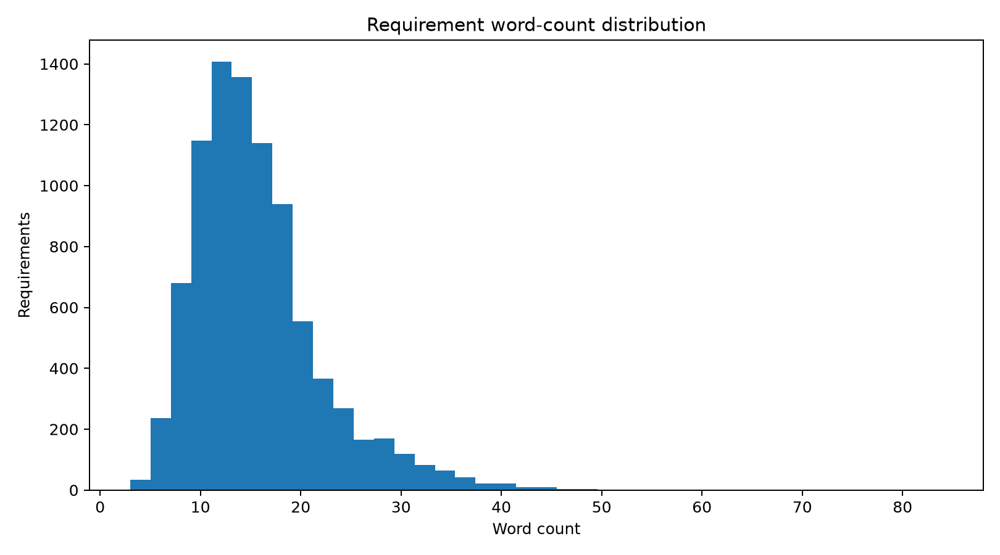

# Dataset Exploration and Preparation

This directory documents the examination, quality assessment, provenance checks, and preparation of a multi-source software requirements dataset for **Functional Requirement (FR) versus Non-Functional Requirement (NFR) classification**. The objective was to select a defensible research subset and establish a reproducible, leakage-aware evaluation split before model development.

## Workflow

The investigation progressed through four groups of scripts. The numbering reflects the order of analysis rather than four independent datasets.

| Stage | Scripts | Main activities |
|---|---|---|
| Initial exploration | `scripts_1/` (00–07) | File inventory, schema comparison, missing values, class distribution, project/source coverage, text lengths, and overlap candidates |
| Source and label diagnostics | `scripts_2/` (08–18) | Source provenance matching, label taxonomy, conflicting annotations, repeated texts, D4/D5 audits, and PROMISE overlap |
| Dataset suitability | `scripts_3/` (19–24) | Independent class support, duplicate and conflict risk, project coverage, and candidate dataset comparison |
| Final verification and freezing | `scripts_4/` (25–56) | Label and source audits, near-duplicate checks, grouping/split feasibility, candidate manifests, D2 protocol revisions, frozen D2 v1.1 split, and readiness audit |

## Dataset origin and research subset

This study starts with **A Unified Multi-Source Dataset of Software Requirements**, a **combined dataset** assembled from multiple source datasets. The supplied merged CSV contains **8,854 requirement records** categorized under five source identifiers, `D1` through `D5`. It is **not** a single homogeneous dataset: sources differ in label schemes, repeated requirements, provenance, and project metadata.

The complete merged dataset was explored, but **the models were not trained and tested on all 8,854 records**. The research selected the **D2 partition** for the binary **FR vs NFR** task after comparing the five constituent sources.

| Dataset level | Records | Role in this study |
|---|---:|---|
| Combined multi-source dataset (`D1`–`D5`) | 8,854 | Initial inventory, source comparison, quality and provenance investigation |
| Source partition `D2` (before final filtering) | 4,993 | Candidate source selected for binary FR/NFR classification |
| **Validated D2 v1.1** | **4,833** | **Actual dataset used for model development and held-out evaluation** |

**How D2 became D2 v1.1:** scripts audited labels against the original FR/NFR reference, normalized and deduplicated texts, excluded unresolved or conflicting cases, grouped closely related requirements, and revisited cross-partition near-duplicates. The final v1.1 candidate contains **4,833 distinct requirements**. This is a *filtered subset of D2*, not a new dataset created by combining all five source partitions into a binary label space.

The original merged CSV, accompanying processed CSV, ZIP, and extracted source files reside in `../A Unified Multi-Source Dataset of Software Require/`. They may be absent from a public Git repository because the source data is ignored locally.

### Which partition was used for training and testing?

**Only D2 v1.1**, split as follows. Models used the **training partition** to fit parameters, the **validation partition** for checkpoint selection and comparative model development, and the **held-out test partition** for the final evaluation after selecting and freezing the model. The final test partition was not used for tuning.

## Frozen D2 v1.1 split

The final validated research split is recorded in `outputs/validated/54_d2_v11_frozen_split_manifest.csv`, with its configuration and integrity hashes in `outputs/validated/54_d2_v11_split_metadata.json`.

| Partition | Requirements | FR | NFR | Similarity groups |
|---|---:|---:|---:|---:|
| Train | 3,378 | 2,224 | 1,154 | 3,237 |
| Validation | 728 | 489 | 239 | 694 |
| Test (held out) | 727 | 488 | 239 | 694 |
| **Total** | **4,833** | **3,201** | **1,632** | **4,625** |

**Split methodology:** The D2 candidates underwent duplicate/near-duplicate grouping, label consistency checks, partition feasibility assessment, and cross-partition similarity auditing. The resulting manifest keeps the audited similarity groups within individual partitions. Dataset readiness was verified in Scripts **54–56**. The held-out test split was reserved for evaluation after model selection. The selected seed-42 DistilBERT checkpoint was later evaluated **once** on the 727-test-requirement split under the frozen protocol; those test outputs are in `../final_model/`, not this exploration folder.

This split reduces leakage caused by closely related texts, but it **does not establish project-level independence**. The source-label taxonomy, data provenance, and independent human annotation verification also retain documented limitations; the readiness decision should not be interpreted as unconditional dataset-quality approval.

## Modeling connection

The same frozen D2 v1.1 manifest was reused by separate modeling stages, so the classical ML and deep learning experiments are tied to **the same dataset definition and train/validation/test partitions**, rather than independently assembled subsets.

| Project folder | Use of D2 v1.1 |
|---|---|
| [`../research_modeling/`](../research_modeling/) | Classical ML training, cross-validation, and validation comparisons |
| [`../deep_learning_research/`](../deep_learning_research/) | CNN/BiLSTM and transformer training, validation, three-seed stability analysis, and model selection |
| [`../final_model/`](../final_model/) | Frozen DistilBERT seed-42 model and **final held-out test evaluation** |

The final test run reported **NFR F1 = 0.8421** and **accuracy = 0.8927** on **727 test requirements**. These are downstream evaluation results, not dataset-exploration measurements. Only the selected final model was evaluated on the frozen test; this does not demonstrate test-set superiority to other models.

## Exploratory figures

**Original merged-dataset class distribution**

**Requirement word-count distribution**

These figures describe early exploration of the merged dataset; they should **not** be interpreted as the final D2 v1.1 class distribution. Use the frozen split table above for final research counts.

## Directory guide

| Path | Contents |
|---|---|
| `scripts_1/` … `scripts_4/` | Numbered, reproducible exploration and audit scripts |
| `outputs/tables/` | Tabular summaries, matching evidence, conflicts, grouping diagnostics, and split audits |
| `outputs/reports/` | Methodology notes, limitations, readiness records, and protocol documents |
| `outputs/figures/` | Exploratory visualizations |
| `outputs/validated/` | Candidate datasets, frozen manifest, split metadata, and review records |
| `Docs/THESIS_DATASET_2_COMPLETE_EXPLORATION_RECORD.txt` | Full chronological exploration record |
| `code_outputs_scripts_1.txt` … `code_outputs_scripts_4.txt` | Saved execution logs and results for each script group |

## Reproducibility

Run scripts from the dataset exploration workspace with the project's existing Python environment. Earlier scripts depend on the original dataset files under the parent `THESIS_DATASET_2/` directory. Consult each script's imports and input paths before rerunning stages; later scripts often require artifacts from earlier stages.

Key records for checking the **final dataset protocol**:

- `outputs/reports/46_d2_research_dataset_protocol.md` and `outputs/reports/50_d2_protocol_revision_plan.txt`: protocol background and revision rationale.
- `outputs/reports/54_d2_v11_split_report.txt`: frozen split summary.
- `outputs/reports/55_d2_v11_similarity_audit.txt`: cross-partition similarity audit.
- `outputs/reports/56_d2_v11_readiness.txt` and `.json`: final readiness checks.

**Repository note:** The frozen manifest and some diagnostic CSV's may contain original requirement text. Check the source dataset's redistribution terms before committing files from `outputs/validated/` or `outputs/tables/`; ignoring only the raw dataset folder does not exclude these derived copies.

The modeling stages are maintained separately in `../research_modeling/`, `../deep_learning_research/`, and `../final_model/`.