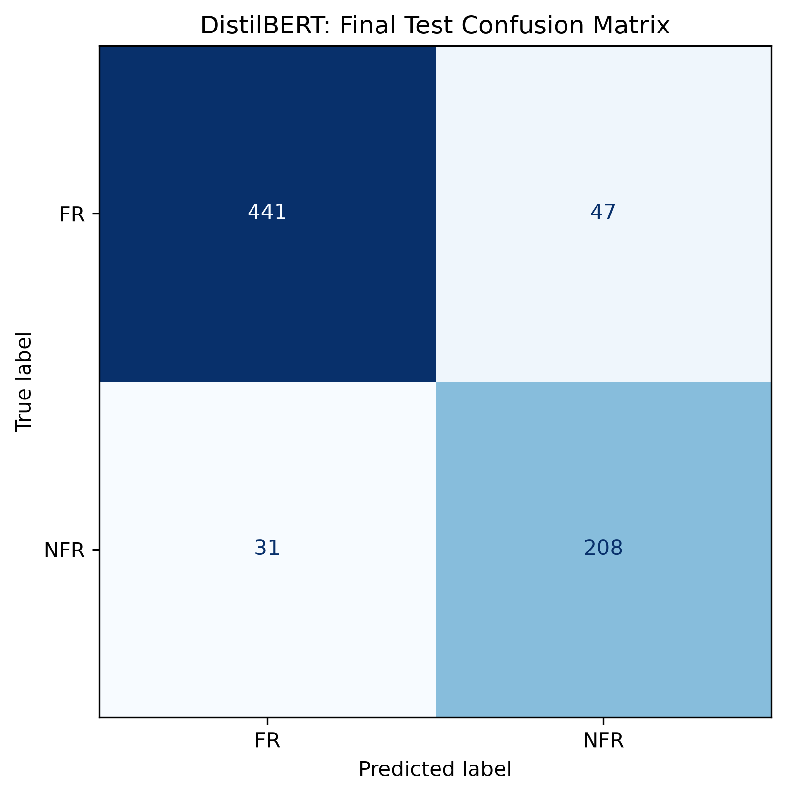
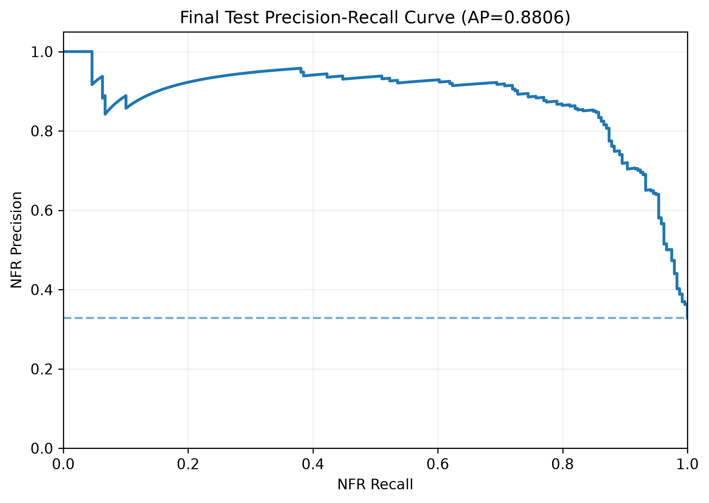
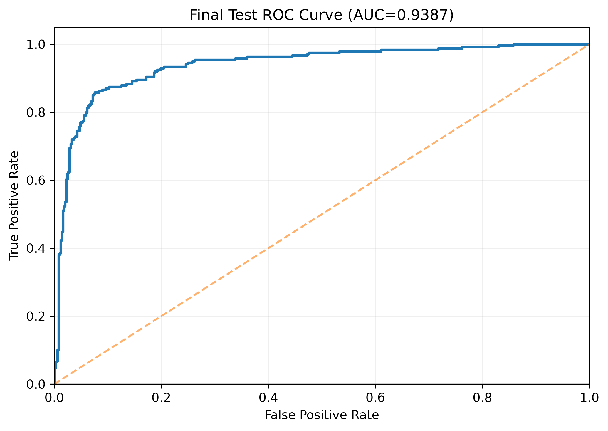
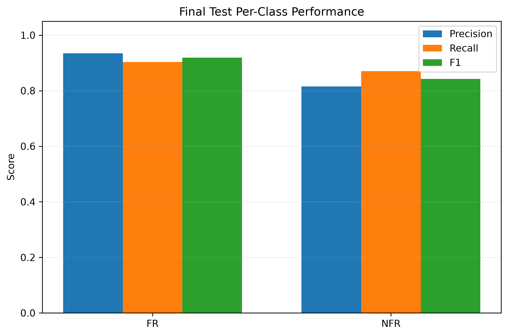

# Final Model: DistilBERT for FR/NFR Requirements Classification

This folder contains the **frozen final model evaluation** for a thesis on automated classification of software requirements as **Functional Requirements (FR)** or **Non-Functional Requirements (NFR)**. It documents the selected DistilBERT checkpoint, the one-time held-out test evaluation, final figures, reports, and integrity-verified research archive.

> **Scope:** Model training, architecture comparisons, and checkpoint selection were completed in [`../deep_learning_research/`](../deep_learning_research/). This folder does **not** retrain or reselect the model.

## 1. Dataset and evaluation protocol

The research began with a **combined multi-source dataset** of 8,854 requirements (source identifiers D1–D5). Following provenance, label-consistency, duplicate, and similarity audits, the study selected the **D2 source partition** and prepared a filtered binary classification dataset, **D2 v1.1**, comprising 4,833 FR/NFR examples. The models were **not trained on the full combined dataset**.

| D2 v1.1 partition | FR | NFR | Total | Use |
|---|---:|---:|---:|---|
| Training | 2,224 | 1,154 | 3,378 | Model fitting |
| Validation | 489 | 239 | 728 | Development and checkpoint selection |
| **Held-out test** | **488** | **239** | **727** | **One-time final evaluation** |
| **Total** | **3,201** | **1,632** | **4,833** | |

The split was frozen before final evaluation and used **similarity-group separation** to prevent identified related requirements from crossing partitions. The authoritative split is [`../dataset_exploration/outputs/validated/54_d2_v11_frozen_split_manifest.csv`](../dataset_exploration/outputs/validated/54_d2_v11_frozen_split_manifest.csv), with its [metadata](../dataset_exploration/outputs/validated/54_d2_v11_split_metadata.json). **Independence at the underlying project level was not established.**

## 2. Selected model and frozen configuration

DistilBERT was selected based on **validation evidence**, including comparison across three random seeds (42, 17, and 29). The original **seed-42** checkpoint was frozen rather than selecting whichever seed produced the highest validation score. The held-out test set was not used for model choice or threshold tuning.

| Setting | Frozen value |
|---|---|
| Architecture | DistilBERT (`distilbert/distilbert-base-uncased`) |
| Checkpoint | `model/distilbert_seed42/` (copied from the selected training checkpoint) |
| Label mapping | `FR = 0`, `NFR = 1` |
| Maximum sequence length | 96 tokens |
| Decision threshold | 0.50 for NFR |
| Random seed | 42 |
| Trainable model parameters | 66,955,010 |
| Final test records | 727 |
| Final inference policy | One held-out test evaluation; no post-test tuning |

Freeze details: [`configs/18_final_model_freeze.json`](configs/18_final_model_freeze.json) and [`outputs/reports/18_final_model_selection_report.txt`](outputs/reports/18_final_model_selection_report.txt).

## 3. Final held-out test results

All numbers below refer to the **727-example held-out test set**, not the validation set.

| Metric | Test result |
|---|---:|
| Accuracy | **0.8927** |
| Balanced accuracy | 0.8870 |
| Macro F1 | 0.8804 |
| Weighted F1 | 0.8936 |
| **NFR precision** | **0.8157** |
| **NFR recall** | **0.8703** |
| **NFR F1** | **0.8421** |
| Average precision (NFR) | 0.8806 |
| ROC AUC (NFR) | 0.9387 |

**Confusion matrix:** rows are actual labels, columns are predicted labels.

| Actual \\ Predicted | FR | NFR |
|---|---:|---:|
| **FR** | 441 | 47 |
| **NFR** | 31 | 208 |

The model correctly classified **649 of 727** requirements; **47 FR** requirements were misclassified as NFR, and **31 NFR** requirements were misclassified as FR. Detailed metrics appear in [`outputs/reports/01_final_test_report.txt`](outputs/reports/01_final_test_report.txt) and the [full final evaluation report](outputs/reports/03_final_evaluation_full_report.txt).

### Evaluation figures

The following images are embedded from versioned PNG artifacts in this folder. PDF versions with the same filenames are available for thesis preparation.

**Confusion matrix**



**Precision–recall curve**



**ROC curve**



**Per-class precision, recall, and F1**



## 4. Finalization workflow

Each script performs a distinct, auditable task:

| Script | Purpose | Training or new inference? |
|---|---|---|
| [`00_verify_final_model.py`](scripts/00_verify_final_model.py) | Check frozen checkpoint and tokenizer hashes, model configuration, and local loadability | No training; model load only |
| [`01_evaluate_final_model.py`](scripts/01_evaluate_final_model.py) | Run the **single planned** held-out test inference and save metrics/predictions | **One test inference** |
| [`02_generate_final_figures.py`](scripts/02_generate_final_figures.py) | Generate PNG/PDF figures from saved, checksum-verified test predictions | No |
| [`03_final_evaluation_report.py`](scripts/03_final_evaluation_report.py) | Recompute and verify saved metrics; compile the final report and comparison tables | No |
| [`04_finalize_research_archive.py`](scripts/04_finalize_research_archive.py) | Verify required artifacts, frozen weights/tokenizer, prediction hash, and create archive inventory | No |

**Final archive status:** `VERIFIED`, with **35 files inventoried** at the time of archiving. See [`outputs/reports/04_archive_integrity_report.txt`](outputs/reports/04_archive_integrity_report.txt) and [`outputs/reports/04_final_research_archive.json`](outputs/reports/04_final_research_archive.json). The archive inventory records integrity of files in the local research workspace; it is **not** a claim that ignored artifacts are all available in this GitHub repository.

## 5. Folder contents

```text
final_model/
├── configs/                  # Frozen model-selection configuration
├── model/                    # Final checkpoint and tokenizer (local; Git-ignored)
├── scripts/                  # Verification, evaluation, plots, reporting, archiving
├── outputs/
│   ├── figures/              # Four figures, each as PNG and PDF
│   ├── tables/               # Class metrics, confusion matrix, comparisons, inventory
│   ├── reports/              # Integrity, evaluation, figure and archive reports
│   └── predictions/          # Per-example final test outputs (Git-ignored)
├── logs/                     # Local logs (Git-ignored)
└── README.md
```

### Useful artifacts

| Artifact | Location |
|---|---|
| Frozen selection configuration | [`configs/18_final_model_freeze.json`](configs/18_final_model_freeze.json) |
| Final test metrics (machine-readable) | [`outputs/reports/01_final_test_metrics.json`](outputs/reports/01_final_test_metrics.json) |
| Confusion matrix (CSV) | [`outputs/tables/01_final_test_confusion_matrix.csv`](outputs/tables/01_final_test_confusion_matrix.csv) |
| Validation vs. test comparison | [`outputs/tables/03_validation_test_comparison.csv`](outputs/tables/03_validation_test_comparison.csv) |
| Comprehensive evaluation report | [`outputs/reports/03_final_evaluation_full_report.txt`](outputs/reports/03_final_evaluation_full_report.txt) |
| Research archive verification | [`outputs/reports/04_archive_integrity_report.txt`](outputs/reports/04_archive_integrity_report.txt) |

## 6. Reproducibility and GitHub publication

The scripts were executed in the thesis Python environment on an NVIDIA CUDA-capable machine. For a local workspace with the **original source data, frozen split, installed dependencies, and saved model weights**:

```bash
cd ~/THESIS_DATASET_2/final_model
source ~/Unofficial\ Thesis/.venv-transformers/bin/activate
python scripts/00_verify_final_model.py
```

**Do not rerun `01_evaluate_final_model.py` simply to reproduce the reported numbers.** The final test evaluation is already complete and frozen. For reviewing published results, consult the saved JSON/CSV reports and figures. Scripts 02–04 depend on saved artifacts and their integrity checks; some are excluded from GitHub.

The project `.gitignore` intentionally excludes `model/`, `logs/`, and `outputs/predictions/`. Thus, **cloning the repository alone is insufficient to rerun model inference** or recreate every checksum-verified artifact. The full checkpoint and original input data must be obtained separately under their applicable sharing terms. The included figures, aggregate tables, and reports document the completed evaluation.

## 7. Interpretation and limitations

- The selected model achieved **NFR F1 = 0.8421** on the held-out test; its seed-42 validation NFR F1 was **0.8595**. The difference is descriptive, not a new selection criterion.
- A higher mean validation F1 for DistilBERT across three seeds did **not** establish statistically significant superiority over BERT or RoBERTa.
- The split controlled identified similarity groups, but **project-level independence** and broader external generalization were not verified.
- Source/label provenance and some ambiguous annotations remain research limitations; AI-assisted annotation suggestions were **not** independent human adjudications.
- Because only the chosen final model was tested under the frozen protocol, no held-out comparative superiority claim is made against the other architectures.

For dataset construction, see [`../dataset_exploration/`](../dataset_exploration/). For training and model-selection evidence, see [`../deep_learning_research/`](../deep_learning_research/).
